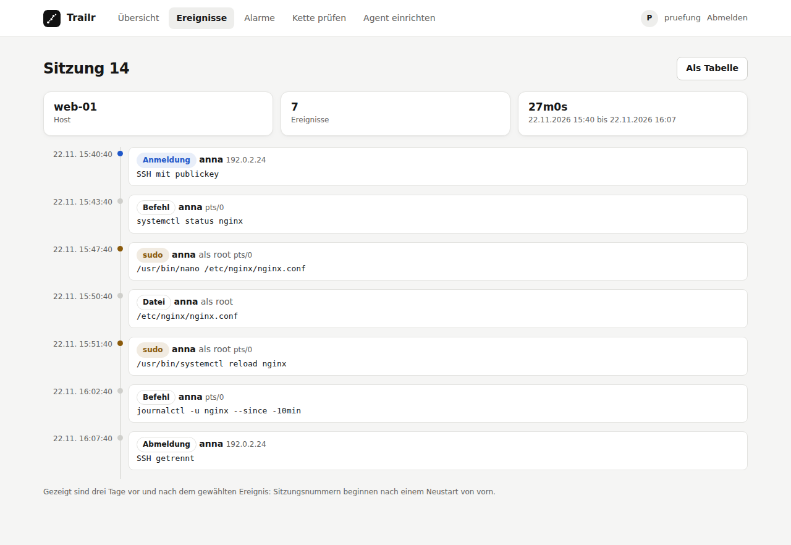

<p align="center"></p>
<h1 align="center">Trailr</h1>
<p align="center">Hält fest, wer was auf deinen Linux-Systemen tut, und merkt, wenn daran gedreht wird.</p>



## Was es kann

| Bereich | Funktionen |
|---|---|
| Erfassen | SSH-Anmeldungen, Sitzungen, sudo, su, Befehle und Dateiänderungen über journald und auditd |
| Ansehen | Übersicht je Host, Filter, Zeitleiste je Sitzung, Export als CSV und JSON |
| Prüfen | Hash-Kette je Host, täglich und auf Knopfdruck nachgerechnet |
| Melden | Fehlschläge, neue Quelle, stiller Agent, gebrochene Kette, sudo außerhalb der Arbeitszeit |
| Übertragen | Puffer auf dem Host, eigener Schlüssel je Host, auf Wunsch mTLS |

## Starten

```bash
cp .env.beispiel .env            # Kennwort und Agent-Schlüssel eintragen
docker compose up -d --build
docker compose logs trailr       # Link mit Einrichtungscode
```

Trailr läuft unter `http://<host>:8400`, davor gehört TLS: Agenten schicken ihren
Schlüssel nur über https. Das erste Konto aus dem Link verwaltet die App, bei
OIDC trägt man den Admin in `TRAILR_ADMIN` ein.

## Agent

Am einfachsten mit der Ansible-Rolle `agent/ansible/trailr_agent`, von Hand
steht es in der App unter "Agent einrichten". Ohne Server geht es auch:

```bash
# /etc/trailr/agent.env
TRAILR_ORDNER=/var/log/trailr
TRAILR_ORDNER_TAGE=365

sudo trailr-agent zeigen -benutzer anna -art sudo
sudo trailr-agent pruefen
```

Beides zugleich geht, dann liegt die Kette an zwei Orten.

## Alarme

Sie stehen immer in der Oberfläche. Telegram und Mail sind aus, bis sie in der
`.env` stehen (`.env.beispiel`). Gemeldet wird ohne Befehlszeilen.

## mTLS

Mit `TRAILR_MTLS_PORT` nimmt Trailr Lieferungen nur noch dort an. Der Name im
Zertifikat muss der des Hosts sein, der Schlüssel des Hosts gilt weiter. Der
Port muss in `docker-compose` selbst freigegeben werden.

## Grenzen

* Die Kette ist nicht signiert. Wer in die Datenbank schreiben oder auf einem Host root werden kann, kann sie ganz neu rechnen. Dagegen hilft der zweite Ort.
* Jedes angemeldete Konto liest alle Ereignisse, auch Befehlszeilen. Konten also sparsam vergeben.
* Ohne auditd fehlen sudo, su, Befehle und Dateien.
* Pakete und Dienste erscheinen als Befehle, nicht als eigene Art.

## Entwickeln

```bash
go test ./...
# mit Datenbank; sie wird geleert, der Name muss mit pruef beginnen
TRAILR_TEST_DB=postgres://.../pruef_trailr go test -p 1 ./...
make agent-pruefsumme   # nach jeder Änderung am Agenten in die Rolle eintragen
```

Go 1.27.4, PostgreSQL 17. Lizenz: MIT, siehe [LICENSE](LICENSE).
